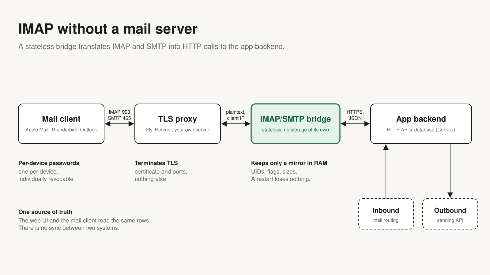

# Convex Mail Bridge

Let Apple Mail, Thunderbird and Outlook read and send the messages of your
[Convex](https://convex.dev) app over IMAP and SMTP, without running a mail server.



Your app already stores mail: support threads, a shared inbox, messages that arrive through an
inbound webhook and leave through a sending API. Your users would still like to see that mail in
the mail program they use all day. A classic answer is to run an IMAP server next to the app and
keep two stores in sync. This project takes the other road:

- **A Convex component** (`@nordwerk/convex-mail-bridge`) gives every message a stable IMAP UID,
  keeps flags and counters per folder, and manages what mail clients sign in with: one password
  per device, individually revocable.
- **A small Go service** (`bridge/`) speaks IMAP and SMTP submission to mail clients. It has no
  disk and no database. Everything it serves it fetches from your app over ten HTTP routes; a
  restart loses nothing.
- **Your app stays the only store.** The web UI and the mail client read the same rows. Reading a
  message in Apple Mail marks it read in your app, in the same transaction.

## Status

Early. The component and the Go bridge run in production for one small team. The client layer in
`src/client`, which connects them to *your* tables, is that team's app-specific edge re-cut for
general use: it is covered by the test suite here but has not carried production traffic in this
shape yet. The example app has been run on a local Convex backend with the Go bridge in front of
it, where the probe (`bridge/test/against-edge.sh`) and `mbsync` passed; a real mail program, a
cloud deployment and production load have not been tried against it. Expect breaking changes
before 1.0.

The package is not on npm yet. Version 0.1.0 follows; until then the install line below does not
resolve.

What works today: `INBOX` and `Sent`, reading, read and other flags in both directions, delete
(hidden for mail clients), IDLE (new mail appears within seconds), sending over SMTP, shared
mailboxes, profile files for Apple devices. Not yet: further folders (archive, trash), moving
messages, server-side search in message content, drafts on the server. The details are in
[docs/limits.md](docs/limits.md).

## Is this for you?

Yes, if you have a Convex app that holds messages as RFC 822 bytes (or can produce them) and want
to offer them to standard mail clients.

No, if you need a general-purpose mail server, want to receive mail from the internet over SMTP
(the bridge only accepts submissions from signed-in devices and hands them to your app), or do
not keep the raw message.

## Quick start

It takes four small pieces in your app. The complete version of what follows is the example app
in [`example/convex`](example/convex), and the walk-through with every option is
[docs/integration.md](docs/integration.md).

**1. Install and mount the component.**

```sh
npm install @nordwerk/convex-mail-bridge
```

```ts
// convex/convex.config.ts
import { defineApp } from 'convex/server'
import mailBridge from '@nordwerk/convex-mail-bridge/convex.config.js'

const app = defineApp()
app.use(mailBridge)
export default app
```

**2. Answer the bridge's questions.** Which mailbox is this address, who owns it, where are the
bytes of a message, and what happens in your data when a mail client marks something read.

```ts
// convex/mailBridge.ts
import { MailBridge } from '@nordwerk/convex-mail-bridge'
import { components } from './_generated/api'
import type { DataModel } from './_generated/dataModel'

export const bridge = new MailBridge<DataModel>(components.mailBridge)

export const { login, seq, folders, entries, changes, raw, store, expunge, append, submitCheck, session, cleanup } =
  bridge.edge({
    mailboxByAddress: async (ctx, address) => {
      const mailbox = await ctx.db
        .query('mailboxes')
        .withIndex('by_address', (q) => q.eq('address', address))
        .unique()
      return mailbox ? { mailboxKey: mailbox._id, ownerKey: mailbox.ownerId } : null
    },
    mailboxOwner: async (ctx, mailboxKey) => {
      const id = ctx.db.normalizeId('mailboxes', mailboxKey)
      return id ? ((await ctx.db.get('mailboxes', id))?.ownerId ?? null) : null
    },
    rawLocation: async (ctx, { mailboxKey, messageKey }) => {
      const id = ctx.db.normalizeId('messages', messageKey)
      const message = id ? await ctx.db.get('messages', id) : null
      // Check that the message belongs to the mailbox of the session.
      return message?.mailboxId === mailboxKey ? message.rawStorageId : null
    },
    onSeen: async (ctx, { messages }) => {
      // Bring your own read state in line; see the example app.
    },
  })
```

**3. Mount the routes.**

```ts
// convex/http.ts
import { httpRouter } from 'convex/server'
import { internal } from './_generated/api'
import { bridge } from './mailBridge'

const http = httpRouter()
bridge.registerRoutes(http, {
  functions: internal.mailBridge,
  // submit: async (ctx, submission) => { ...send with your provider... },
})
export default http
```

Reading works without `submit`. When you add it, the mutation that records the sent message asks
the `session` function once more, because the session was checked before the message was read;
[step 4 of the walk-through](docs/integration.md#4-mount-the-routes) shows how.

**4. Tell the ledger what happens to messages.** In the mutation that stores a message:

```ts
await bridge.enable(ctx, { mailboxKey: mailboxId, ownerKey: userId }) // once per mailbox
await bridge.place(ctx, {
  mailboxKey: mailboxId,
  messageKey: messageId,
  folder: 'INBOX', // or 'Sent'
  size, // exact byte length of the raw message
  internalDate: Date.now(),
  seen: false,
})
```

Then set the shared secret, create a device password, and start the bridge:

```sh
npx convex env set MAIL_BRIDGE_SECRET "$(openssl rand -hex 32)"
```

```sh
cd bridge
docker build -t mail-bridge .
docker run --rm -p 127.0.0.1:1143:1143 -p 127.0.0.1:1465:1465 \
  -e CONVEX_SITE_URL=https://<deployment>.convex.site \
  -e MAIL_BRIDGE_SECRET=<the same secret> \
  -e PROXY_PROTOCOL=off \
  mail-bridge
```

That is enough to try it on your own machine without TLS. For real use the bridge sits behind a
TLS proxy on ports 993 and 465; [docs/operations.md](docs/operations.md) has a walk-through for
Fly.io and one for Docker Compose with HAProxy on your own server.

## How it fits together

| Part | Where it runs | What it holds |
| --- | --- | --- |
| Your tables | your Convex app | messages, mailboxes, users: the only store |
| Component `mailBridge` | your Convex deployment, isolated | UIDs, flags, counters, device password hashes, sessions |
| Client layer (`MailBridge`) | your Convex app | nothing; it connects your tables to the component and serves `/bridge/v1/*` |
| Bridge (Go) | anywhere behind a TLS proxy | nothing durable: a mirror of folder rows and a cache of recent messages in memory |

More in [docs/architecture.md](docs/architecture.md). The HTTP interface between bridge and app is
specified in [docs/edge-contract.md](docs/edge-contract.md), so either side can be replaced.

## Security in short

- Mail clients sign in with **device passwords** (192 bit, generated, shown once). Only their
  SHA-256 is stored. One per device, revocable one by one; a revoked password ends its open
  connections within seconds.
- Bridge and app share **one secret**. Without it every route answers `401`, and so does a secret
  shorter than 32 characters.
- Every request names its mailbox through a **session token** only, never through a field in the
  request, and your access callbacks run on every request in the same transaction as the work.
  Sending is the one place where that work is yours: your `submit` gets a handle to repeat the
  check in the mutation that records the message.
- Failed sign-ins are throttled per address and client IP; neither is stored in clear.
- TLS ends at the proxy in front of the bridge. Whoever runs that proxy can read the traffic.

The full model, including what the bridge keeps in memory, is in
[docs/security.md](docs/security.md). To report a vulnerability see [SECURITY.md](SECURITY.md).

## Documentation

- [docs/integration.md](docs/integration.md): connecting your app, every callback and method
- [docs/architecture.md](docs/architecture.md): the parts and how a request flows
- [docs/edge-contract.md](docs/edge-contract.md): the HTTP contract between bridge and app
- [docs/operations.md](docs/operations.md): deploying and running the bridge
- [docs/security.md](docs/security.md): security model
- [docs/limits.md](docs/limits.md): known limits and what is not verified
- [bridge/README.md](bridge/README.md): the Go service, its settings, local development

## Development

```sh
npm install
npm run check        # build, typecheck, lint, tests (convex-test, no deployment needed)
```

The Go service needs only Docker:

```sh
cd bridge
docker run --rm -v "$PWD":/src -w /src golang:1.24 sh -c 'go vet ./... && go test -race ./...'
```

See [CONTRIBUTING.md](CONTRIBUTING.md).

## License

MIT, see [LICENSE](LICENSE).
