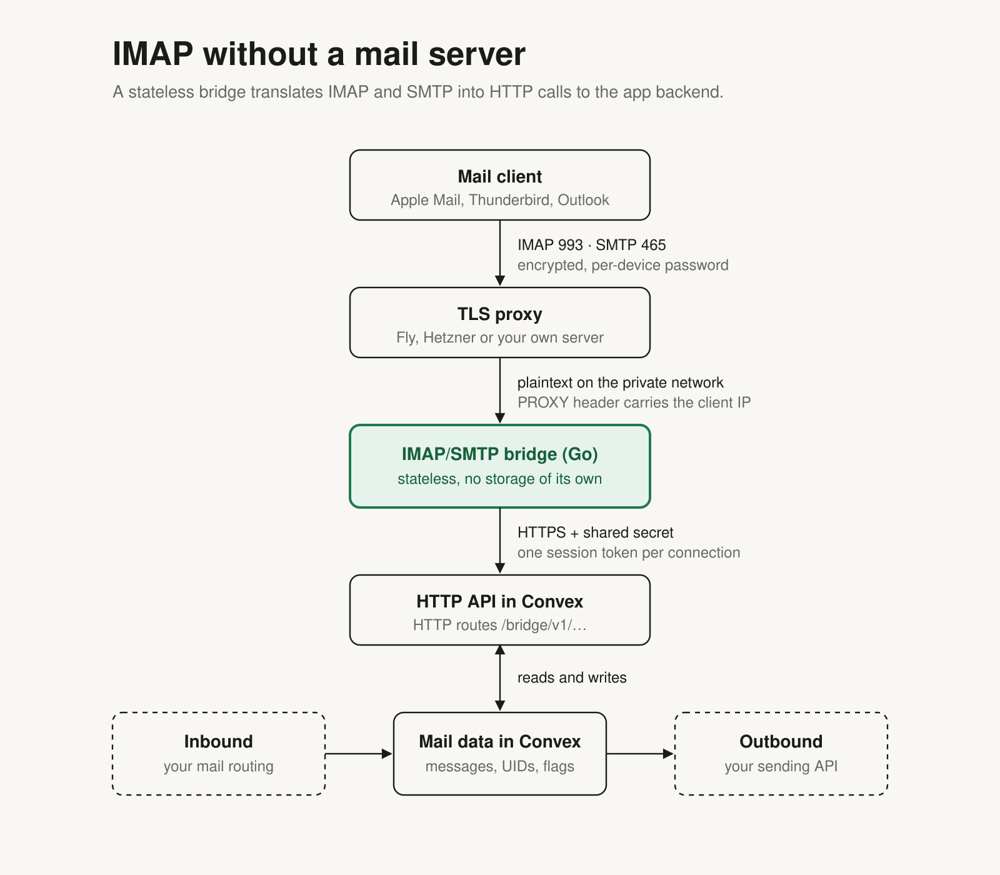

# Architecture

## The parts

**Your app's tables** are the only place messages live. Nothing below holds a second copy that
could drift.

**The component `mailBridge`** lives in your Convex deployment, isolated from your tables. It
holds what IMAP needs on top of a message store:

| Table | Content |
| --- | --- |
| `folders` | per mailbox and folder: `uidValidity`, `uidNext`, `highestModseq`, counts of existing and unseen messages |
| `entries` | per message one current row: its UID in its folder, flags, size, date, a change state (`modseq`), and whether it is live or a tombstone |
| `state` | per mailbox: owner, a change counter (`seq`), state of the initial backfill |
| `devicePasswords` | hashes of device passwords with label, owner, last use, revocation |
| `sessions` | hashes of session tokens, each bound to one device password |
| `setupLinks` | one-time set-up links for phones (hashes only) |
| `loginAttempts` | counters of failed sign-ins per hashed key |

Every key that crosses into the component is an opaque string your app chose: `mailboxKey`,
`messageKey`, `ownerKey`, optionally `userKey`. The component never sees an address, a subject or
a body.

**The client layer** (`MailBridge` in `src/client`) is a library that runs inside your app. It
wraps the component's functions, builds the queries and mutations behind the HTTP routes, and
mounts the routes. It exists because a Convex component cannot read the app's tables, has no
`ctx.auth` and does not see the app's environment variables: everything that needs your data or
your secret has to run on your side of the boundary.

**The bridge** (`bridge/`, Go) terminates IMAP and SMTP submission. It keeps two things in
memory, both bounded: a mirror of folder rows (UID, flags, size, date) per mailbox, and a cache
of recently fetched raw messages. It has no disk and no database, knows nothing about Convex
beyond the HTTP contract, and can be restarted or run as several instances without coordination,
because each one asks the edge.

**A TLS proxy** in front of the bridge terminates TLS and tells the bridge the client's address
(PROXY protocol).

## Who tells whom

The ledger follows your app, not the other way round. When your app stores a message, the same
mutation calls `place`, and the component assigns the next UID. When a message is read or deleted
in your app, the same mutation calls `setSeen` or `remove`. Because calls into a component commit
together with the calling mutation, the ledger cannot say something your tables do not.

In the other direction, a mail client's change arrives at the edge, which updates the ledger and
calls your callback (`onSeen`, `onExpunge`) in one mutation.

## What happens when

**New mail arrives.** Your inbound handler stores the message and calls `place`. The component
gives it UID `n` in `INBOX` and raises the mailbox's change counter. The bridge asks for the
counters of all mailboxes with open connections every two seconds (one request for all of them,
`/seq`), sees the change, fetches what changed in the open folders (`/changes`), and tells
clients that sit in IDLE that a message exists. Without open connections the bridge asks
nothing.

**A client opens a folder.** The bridge serves the list from its mirror. If it has none for this
mailbox, it reads the folder page by page (`/entries`). On reconnect it only asks for changes
since the state it knows.

**A client opens a message.** The bridge asks for the bytes (`/raw`) unless they are in its
cache. The edge finds the row by UID in the session's mailbox, asks your `rawLocation` where the
bytes are, and streams them. Header fields, structure and body parts that IMAP clients request
are computed by the bridge from those bytes.

**A client marks a message read.** `/store` updates the row's flags and change state and calls
your `onSeen`; both commit together. Other connected clients of the same mailbox learn about it
through the change counter.

**A client deletes a message.** `/expunge` turns the row into a tombstone. The message
disappears for mail clients; your data is untouched unless your `onExpunge` does something.

**A client sends a message.** It hands the message to the bridge over SMTP. The bridge passes
envelope and bytes to `/submit`, and your `submit` callback sends it with your provider, stores it
and places it in `Sent`. The mutation that stores it checks the session once more. When the client then files its own copy in `Sent` (IMAP `APPEND`), the
edge recognizes the Message-ID and answers with the message that is already there.

## Numbers that never change

IMAP clients cache aggressively and identify messages by `(UIDVALIDITY, UID)`. The ledger
guarantees what they rely on:

- A UID is assigned once and never reused, also not after a delete.
- `uidValidity` of a folder is set when the folder is created and stays.
- Every change gets its own `modseq`, unique in its folder, so "what changed since X" has an exact
  answer and paging through changes loses nothing.
- Removed rows stay as tombstones, so a client that was offline learns about the removal. Cleanup
  deletes tombstones after the retention time and remembers up to which state it did so; a
  mirror older than that is told to read the folder again (`410 resync`) instead of getting an
  incomplete answer.

## Sessions

The bridge signs in once per client connection with the address and device password the client
sent (`/login`) and gets a session token for exactly one mailbox. From then on the token is the
only thing that names the mailbox. On every request the edge checks, in the same transaction as
the work: token known and not expired, device password not revoked, mailbox still owned by the
owner who enabled it, and, for members of shared mailboxes, that your app still allows them.
Tokens of open connections are re-checked with every `/seq` poll, so a revocation closes
connections within seconds. Sending is the one case where the work is not the edge's: `/submit`
checks before it reads the message, and the mutation of your app that records the message
checks again through the `session` function (see [integration.md](integration.md#4-mount-the-routes)).

## Why HTTP between bridge and app

Convex functions are reached over HTTP, and an IMAP server needs long-lived TCP connections that
Convex does not offer. Keeping the protocol work in a separate stateless process means the part
that faces mail clients can be deployed and scaled like any container, while all state and all
access decisions stay in the database. The contract between the two is small and written down
([edge-contract.md](edge-contract.md)), and the bridge's test suite runs against an in-memory
implementation of it (`bridge/internal/edgestub`).

## Folders beyond INBOX and Sent

The ledger already models `Archive`, `Trash` and `Later`, including moving a whole group of
messages (for example a thread) between folders with new UIDs and `move` tombstones. The edge
lists such folders and guards them with a version check at sign-in. Moving messages from a mail
client (`/move`) and the bridge side of it are not finished. Treat everything about extra folders
as experimental.
